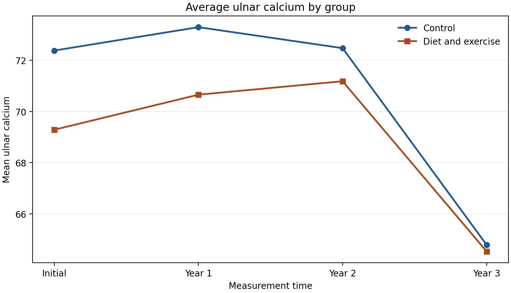

<!-- 加载 tidyverse 来整理数据和画图，加载 knitr 来制作表格。 -->

```{r}
#| label: setup
#| include: false

# 加载整理数据和绘图所需的函数。
# Follow the Tidyverse Style Guide.
library(tidyverse)
# 加载 kable() 来排版表格。
library(knitr)

```

# Diamonds

<!-- 删除任一尺寸为零的钻石。把长、宽、高合并成一列，再按尺寸和净度分组统计。 -->

```{r}
#| label: prepare-diamonds

# Keep diamonds with nonzero length, width, and height.
# 从课堂的 diamonds 数据开始计算汇总统计量。
diamond_summary <- diamonds |>
  # 排除长、宽、高任一尺寸为零的钻石。
  filter(x != 0, y != 0, z != 0) |>
  # 只保留净度和三个尺寸。
  select(clarity, x, y, z) |>
  # 把三个尺寸列转成长格式，每行对应一个尺寸值。
  pivot_longer(
    cols = c(x, y, z),
    names_to = "dimension",
    values_to = "measurement"
  ) |>
  # 按尺寸和净度分组。
  group_by(dimension, clarity) |>
  # 每组计算频数、分位点、中位数、均值和标准差。
  summarize(
    # 统计组内的钻石数。
    Frequency = n(),
    # 最小值是第 0 百分位。
    `0%` = min(measurement),
    # 求第 20 百分位。
    `20%` = quantile(x = measurement, probs = 0.20),
    # 求第 40 百分位。
    `40%` = quantile(x = measurement, probs = 0.40),
    # 求组内中位数。
    Median = median(measurement),
    # 求第 60 百分位。
    `60%` = quantile(x = measurement, probs = 0.60),
    # 求第 80 百分位。
    `80%` = quantile(x = measurement, probs = 0.80),
    # 最大值是第 100 百分位。
    `100%` = max(measurement),
    # 求样本算术平均数。
    Mean = mean(measurement),
    # 求样本标准差。
    SD = sd(measurement),
    # 出表前解除分组。
    .groups = "drop"
  ) |>
  # 把净度列名改成表格使用的大写开头。
  rename(Clarity = clarity)

```

I compared the length, width, and height of diamonds by clarity. All three measurements are in millimeters. I left out any diamond with a zero for length, width, or height.

## Length

<!-- x 代表长度。kable() 把统计结果排成表，tbl-cap 提供表注。 -->

```{r}
#| label: tbl-diamond-length
#| tbl-cap: "Diamond length by clarity (mm)"

length_summary <- diamond_summary |>
  # 选取这一种尺寸的统计结果。
  filter(dimension == "x") |>
  # 维度已写在表注里，表内删除这一列。
  select(-dimension)

# 排版统计表，显示到两位小数。
kable(length_summary, digits = 2)

```

In @tbl-diamond-length, the median length was `r sprintf("%.2f", length_summary$Median[length_summary$Clarity == "I1"])` mm for I1 and `r sprintf("%.2f", length_summary$Median[length_summary$Clarity == "IF"])` mm for IF. The middle 60% of I1 lengths ran from 6.06 to 7.53 mm. For IF, that range was 4.35 to 5.55 mm. Even the 80th percentile for IF was below the 20th percentile for I1.

## Width

<!-- y 代表宽度。只选宽度这一组统计结果。 -->

```{r}
#| label: tbl-diamond-width
#| tbl-cap: "Diamond width by clarity (mm)"

width_summary <- diamond_summary |>
  # 选取这一种尺寸的统计结果。
  filter(dimension == "y") |>
  # 维度已写在表注里，表内删除这一列。
  select(-dimension)

# 排版统计表，显示到两位小数。
kable(width_summary, digits = 2)

```

In @tbl-diamond-width, the median width was 6.61 mm for I1 and 4.59 mm for IF. The SI2 maximum stood out at 58.90 mm. Its median was 6.41 mm. I used the median to compare typical widths because a value that large can pull the mean up.

## Height

<!-- z 代表高度。行内 R 从表里读取 I1 和 IF 的中位数。 -->

```{r}
#| label: tbl-diamond-height
#| tbl-cap: "Diamond height by clarity (mm)"

height_summary <- diamond_summary |>
  # 选取这一种尺寸的统计结果。
  filter(dimension == "z") |>
  # 维度已写在表注里，表内删除这一列。
  select(-dimension)

# 排版统计表，显示到两位小数。
kable(height_summary, digits = 2)

```

In @tbl-diamond-height, the median height was `r sprintf("%.2f", height_summary$Median[height_summary$Clarity == "I1"])` mm for I1 and `r sprintf("%.2f", height_summary$Median[height_summary$Clarity == "IF"])` mm for IF. That same pattern showed up in the length and width tables. In this sample, the I1 group had a higher median in all three dimensions.



# Big Ten Academic Alliance

<!-- 读取球队数据，筛出 Penn State 的 2025–26 赛季比赛，再按日期排序。虚线表示得分等于失分。 -->

```{r}
#| label: fig-psu-games
#| fig-cap: "Penn State points scored and allowed by game, 2025–26"
#| fig-alt: "Each point is one game. A blue line connects games by date. Points above the dashed equal-score line are losses, and points below it are wins."

# Keep Penn State games with usable scores.
# 从同一项目文件夹读取球队数据。
team_raw <- read_csv(
  file = "team_box.csv",
  show_col_types = FALSE
)

# 筛选该赛季宾州州立大学的有效比赛比分。
psu_games <- team_raw |>
  filter(
    team_id == 213,
    season == 2026,
    !is.na(game_date),
    !is.na(team_score),
    !is.na(opponent_team_score),
    team_score >= 0,
    opponent_team_score >= 0,
    team_score != opponent_team_score
  ) |>
  select(
    game_id,
    game_date,
    points_scored = team_score,
    points_allowed = opponent_team_score
  ) |>
  # 先按日期排列，同一天按比赛编号排序。
  arrange(game_date, game_id)

# Count wins and losses and find the highest-scoring game.
psu_wins <- sum(psu_games$points_scored > psu_games$points_allowed)
psu_losses <- sum(psu_games$points_scored < psu_games$points_allowed)

top_game <- psu_games |>
  arrange(desc(points_scored), game_date, game_id) |>
  slice(1)

# Plot points scored against points allowed.
psu_plot <- ggplot(
  data = psu_games,
  mapping = aes(x = points_scored, y = points_allowed)
) +
  # 画出得分等于失分的虚线。
  geom_abline(
    slope = 1,
    intercept = 0,
    linetype = "dashed",
    color = "gray50"
  ) +
  # 按数据中的日期顺序连接比赛。
  geom_path(
    mapping = aes(group = 1),
    color = "steelblue",
    alpha = 0.5
  ) +
  geom_point(color = "navy", size = 2.5) +
  # 让两个坐标轴采用相同的单位长度。
  coord_equal() +
  labs(
    # 缩短图内标题；赛季仍显示在 Figure 1 的图注中。
    title = "Penn State Women's Basketball",
    subtitle = "The blue line connects games in date order.",
    x = "Penn State points scored",
    y = "Penn State points allowed",
    caption = "Source: NCAA Women's Basketball Data"
  ) +
  theme_minimal()

psu_plot

```

In @fig-psu-games, each point is one Penn State game. I connected the games by date, but the blue line crossed itself so often that I found the dashed line easier to read. A point below the dashed line is a win because Penn State scored more than it allowed. The games shown include `r psu_wins` wins and `r psu_losses` losses.

Penn State's highest-scoring game in the plot ended `r top_game$points_scored`–`r top_game$points_allowed`. I was surprised that the team scored that much and still lost.



# Monte Carlo Numerical Integration

<!-- mc_points() 在矩形内生成随机点。make_mc_plot() 判断每个点在曲线上方还是下方，并用下方点的比例估计面积。Quarto 把四张图排成两列。 -->

```{r}
#| label: fig-weibull-simulation
#| fig-cap: "Estimating the area under a Weibull curve from 0 to 4"
#| fig-alt: "Four panels show random points above and below the same Weibull curve. The samples contain 10, 100, 1,000, and 10,000 points."
#| fig-subcap: ["10 points", "100 points", "1,000 points", "10,000 points"]
#| layout-ncol: 2

# Generate random points inside the rectangle.
# 用给定范围生成指定数量的均匀随机点。
mc_points <- function(n, x_min, x_max, y_min, y_max) {
  points <- data.frame(
    # 在矩形的横轴范围内抽取坐标。
    x = runif(n = n, min = x_min, max = x_max),
    # 在矩形的纵轴范围内抽取坐标。
    y = runif(n = n, min = y_min, max = y_max)
  )

  return(points)
}

# Classify the points and estimate the area under the curve.
# 用一套统一的绘图代码展示不同样本量。
make_mc_plot <- function(points) {
  plot_data <- points |>
    mutate(
      # 计算每个横坐标处的 Weibull 密度。
      density = dweibull(x = x, shape = 1.5, scale = 1),
      # 根据纵坐标与密度的大小关系标记随机点。
      flag = if_else(
        condition = y <= density,
        true = "On/below",
        false = "Above"
      ),
      flag = factor(flag, levels = c("Above", "On/below"))
    )

  # 用宽乘高得到矩形面积。
  rectangle_area <- (4 - 0) * (0.8 - 0)
  # 计算落在曲线上或下方的点所占比例。
  proportion_below <- mean(plot_data$flag == "On/below")
  # 用矩形面积乘比例估计积分。
  estimated_integral <- rectangle_area * proportion_below

  ggplot(
    data = plot_data,
    mapping = aes(x = x, y = y)
  ) +
    geom_point(
      mapping = aes(color = flag),
      size = 0.8,
      alpha = 0.65
    ) +
    # 叠加同一个 Weibull 密度函数。
    stat_function(
      fun = dweibull,
      args = list(shape = 1.5, scale = 1),
      xlim = c(0, 4),
      n = 1001,
      color = "black",
      linewidth = 0.9
    ) +
    # 为曲线两侧的点指定固定颜色。
    scale_color_manual(
      values = c("Above" = "#D55E00", "On/below" = "#0072B2"),
      drop = FALSE
    ) +
    # 四个面板使用相同的横纵轴范围。
    coord_cartesian(
      xlim = c(0, 4),
      ylim = c(0, 0.8),
      expand = FALSE
    ) +
    labs(
      x = "x",
      y = "y",
      color = "Point location",
      caption = paste0(
        "Estimated integral: ",
        sprintf("%.4f", estimated_integral)
      )
    ) +
    theme_minimal(base_size = 11) +
    theme(
      legend.position = "bottom",
      plot.caption = element_text(hjust = 1),
      panel.grid.minor = element_blank()
    )
}

# Use the same seeds and sampling order as HW 3.4.
# 固定随机数序列，使重复运行得到相同的点。
set.seed(184)

points1000 <- mc_points(
  n = 1000,
  x_min = 0,
  x_max = 4,
  y_min = 0,
  y_max = 0.8
)

# 为其他三组样本重新设置随机种子。
set.seed(185)

points10 <- mc_points(
  n = 10,
  x_min = 0,
  x_max = 4,
  y_min = 0,
  y_max = 0.8
)

points100 <- mc_points(
  n = 100,
  x_min = 0,
  x_max = 4,
  y_min = 0,
  y_max = 0.8
)

points10000 <- mc_points(
  n = 10000,
  x_min = 0,
  x_max = 4,
  y_min = 0,
  y_max = 0.8
)

# Display the four plots in order of sample size.
make_mc_plot(points = points10)
make_mc_plot(points = points100)
make_mc_plot(points = points1000)
make_mc_plot(points = points10000)

```

In @fig-weibull-simulation, I drew random points inside a rectangle with an area of 3.2. I multiplied 3.2 by the share of points on or below the curve to estimate the area.

My estimates were 0.6400, 0.7680, 0.9760, and 1.0035 for 10, 100, 1,000, and 10,000 points. The exact area from 0 to 4 is $1 - \exp(-8)$, or about 0.9997. With 10 points, one more point landing under the curve changes the estimate by 0.32. With 10,000 points, it changes the estimate by only 0.00032. That helped me see why the smaller sample was more sensitive to where the points landed. My largest sample gave a slightly high estimate. Another sample could give a different result.



# Planning and Prompting GenAI

## My Plan

**Goal.** I wanted to see how average ulnar calcium changed over time in the two groups.

**What I needed.** I needed the original CSV, the group each column belonged to, and the four measurement times.

**Steps.**

**Set up the data**

1. Read the original file. The first four columns are for the control group. The last four are for the diet and exercise group.
2. Give each person an ID within her group. A row in the original file can contain measurements from two different people.
3. Put each measurement on its own row. Keep the person's ID, group, time, and calcium value.

**Check the records**

4. Check for 15 people in the control group and 16 in the diet and exercise group. Check that each person has four measurements and that there are 124 records in all.

**Make and check the plot**

5. Find the mean for each group at each time. Plot the four means for each group on the same time axis. Check that each line has four points in the right order.




## Plan-Informed Response


ChatGPT reported 31 women and 124 measurements. It found the mean for each group at each visit. The plot shows those means, with one line for each group.

| Group | Initial | Year 1 | Year 2 | Year 3 |
|---|---:|---:|---:|---:|
| Control | 72.38 | 73.29 | 72.47 | 64.79 |
| Diet and exercise | 69.29 | 70.66 | 71.18 | 64.53 |


{#fig-calcium-by-group width=85%}



## Generic Response

> I created a visualization showing the average value of each column in your dataset.
>
> What this shows:
>
> - Each point represents the mean (average) of one column (y0, y1, y2, y3, etc.).
> - You can quickly compare which variables tend to have higher or lower values overall.
> - For example, some columns cluster around ~70–73, while others drop closer to ~65.
>
> If you want something more insightful, I can also create:
>
> - Boxplots (to show spread and outliers)
> - Time series plots (if rows represent time/order)
> - Correlation heatmaps
> - Side-by-side comparisons (e.g., y0 vs y0.1)
>
> Just tell me 

<!-- 插入老师在 MOM 提供的通用回复图。 -->

{#fig-calcium-generic width=65%}



## Comparison

In @fig-calcium-generic, ChatGPT found the mean of each column and joined the eight means in file order. The line from `y3` to `y0.1` looks like a rebound at first. Those two points come from different groups and different visits. The first is Year 3 for the control group. The second is the first visit for the diet and exercise group.

In @fig-calcium-by-group, each group has its own line. I can see that both groups dropped from Year 2 to Year 3. I can also compare the groups at the same visit. The table below uses the rounded means shown above.

| Comparison | Difference |
|---|---:|
| Control minus diet and exercise at the first visit | 3.09 |
| Control minus diet and exercise at Year 3 | 0.26 |
| Drop from Year 2 to Year 3 in the control group | 7.68 |
| Drop from Year 2 to Year 3 in the diet and exercise group | 6.65 |

The two lines ended much closer together than they started. These are group averages, so the graph leaves open what happened to each woman. Next time I give an AI tool a file like this, I’ll say which columns belong to each group and give the order of the visits. I’ll also ask it to keep the participant IDs so I can check that each woman has four visits.



# Self-Reflection

When I opened this assignment, I saw a lot of parts and didn’t know where to start. I went back to my grades and read the feedback on a few assignments. Then I worked through one section at a time. That made it easier to get started.

I also learned something from my basketball graph. I added a blue line to show the order of the games. When I read the graph, I looked at the dashed line first. It helped me see which games Penn State won. Next time, I want to think about what the reader needs to see first.

On the November 20 quiz, I knew I had seen some of the questions before. I still got stuck on the first step. During Thanksgiving break, I want to try a few problems with my notes closed. Then I can check where I got stuck and practice those steps before the interview assignment.



# GenAI Usage Appendix

Tool: OpenAI ChatGPT
Model/version: Gpt-6.2 Sol
Date used: 11.20

Questions 13 and 14. I chose ChatGPT for the calcium data task. I shared the files from my instructor, a short summary of the data and the task, and the HW 4.3 rules for using AI. I also shared my plan. I asked ChatGPT to follow the plan and show how the average calcium level changed over time in each group. ChatGPT gave me a table of group averages and a plot.

Question 18. I asked ChatGPT to use my description of what I did to help write this appendix.



# Code Appendix

<!-- 先整理附录用的代码副本。中文备注保留在 .qmd 中。 -->

```{r}
#| label: prepare-code-appendix
#| include: false

# 依原顺序收集代码块，排除附录专用的代码块。
appendix_chunks <- knitr::knit_code$get()
appendix_labels <- setdiff(
  names(appendix_chunks),
  c("prepare-code-appendix", "code-appendix")
)
appendix_lines <- unlist(appendix_chunks[appendix_labels], use.names = FALSE)

# 只从附录副本移除含汉字的整行注释。
is_chinese_comment <- grepl(
  "^[[:space:]]*#.*[\\x{4E00}-\\x{9FFF}]",
  enc2utf8(appendix_lines),
  perl = TRUE
)
knitr::knit_code$set(appendix_english = appendix_lines[!is_chinese_comment])
```

```{r}
#| label: code-appendix
#| ref-label: appendix_english
#| echo: true
#| eval: false
```
